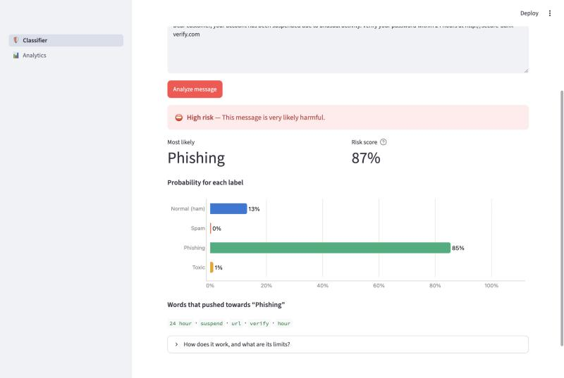
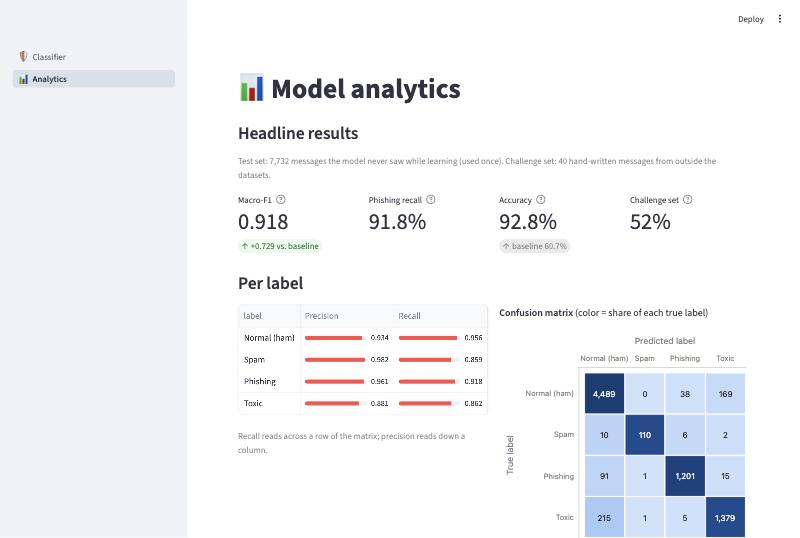

# 🛡️ Spam Shield

[](https://github.com/ennap3a/spam-shield/actions/workflows/ci.yml)

A machine learning and NLP system that classifies a message (email, SMS or chat) as
**normal (ham), spam, phishing or toxic**. It gives a probability for each label and a
risk level, explains which words drove the decision, and shows everything in a
Streamlit app with an analytics dashboard.

**Live demo:** _add the Streamlit Cloud link here after deploying (see [Deploy](#deploy))._

| Classifier | Analytics dashboard |
|---|---|
|  |  |

## Results

| Data | Macro-F1 | Phishing recall | Accuracy |
|---|---|---|---|
| Baseline: always answer "ham" (test) | 0.189 | 0.000 | 0.607 |
| First model: Multinomial Naive Bayes (test) | 0.636 | 0.752 | 0.864 |
| **Final model: calibrated Linear SVM (test, 7,732 messages)** | **0.918** | **0.918** | **0.928** |
| Final model on 40 hand-written challenge messages | 0.495 | 0.200 | 0.525 |

- **Macro-F1** is the main metric, because the labels are imbalanced: accuracy rewards a model
  that ignores the small labels (the always-ham baseline already gets 61%).
- The test set was used **once**. Every choice (features, model, settings, thresholds) was
  made on a validation split or with 5-fold cross-validation on the training data.
- The **challenge set** is the honest reality check (see [Limitations](#limitations)).
  The app's **Suspicious** level (risk ≥ 0.3, chosen on validation) warns about 6 of the 10
  hand-written phishing messages that the label alone misses.

## How it works

```
raw message
  ├─► clean_text: HTML, links → "url", emails → "email", contractions, lowercase, symbols
  │     └─► spaCy: lemmas ("running" → "run"), remove stop words but KEEP "not"/"never",
  │                remove domain words that reveal the source ("enron", "wikipedia")
  │           └─► TF-IDF on words + word pairs (50,000 features)
  └─► metadata on the RAW text: number of links, email addresses, "!", currency signs, digit share
                                         │
        both side by side (ColumnTransformer) ──► LinearSVC ──► sigmoid calibration
                                         │
             probabilities ──► risk = 1 − P(ham) ──► Safe / Suspicious / High risk
```

All steps live in **one scikit-learn Pipeline**, saved as `models/spam_shield_model.joblib`,
so training and the app process text in exactly the same way.

### Key decisions (and the evidence)

| Decision | Evidence |
|---|---|
| LinearSVC over Naive Bayes, Logistic Regression and XGBoost | Best validation macro-F1 (0.905) and best challenge score; 16× faster than XGBoost (`reports/model_comparison.csv`) |
| `C=0.5`, balanced class weights, words + word pairs | Best of 12 settings in 5-fold cross-validation, 0.911 ± 0.005 (`reports/tuning_results.csv`) |
| Sigmoid calibration | When the model says 90%, it is right about 90% of the time; calibration error 1.3% (`reports/reliability.csv`) |
| No message-length features | Length mostly reveals the channel (emails long, SMS short); removing it improved results on new messages (`reports/feature_comparison.csv`) |
| No `uppercase_ratio` | The email dataset was lowercased by its creators, so capitals reveal the source |
| Drop rows > 50,000 characters | One broken CSV row was 17 million characters (thousands of emails glued together) |

## Limitations

These were found with the hand-written challenge set and by inspecting the model's top words:

1. **Each harmful label comes from one channel only.** Spam only exists as SMS, phishing only
   as email, toxic only as chat comments. So the model partly learns the *channel*: spam
   written as an email is usually called phishing.
2. **Old data, old tricks.** The phishing emails are from the early 2000s. Modern scams
   (gift-card requests, "your parcel is held", phishing without a link) are often missed.
3. **Some features still reveal the source**: years (2000–2005) and names from the old email
   datasets appear among the most important words.
4. **Toxicity means swear words to the model.** Polite insults and threats without swear words
   are often missed.

Ideas to fix these are in [BACKLOG.md](BACKLOG.md): mainly adding email spam and SMS phishing data.

## Run it locally

```bash
git clone https://github.com/ennap3a/spam-shield.git
cd spam-shield
python3.12 -m venv .venv
source .venv/bin/activate          # Windows: .venv\Scripts\Activate.ps1
pip install -r requirements.txt    # includes the spaCy English model
pip install -e .
streamlit run app/streamlit_app.py
```

The trained model is in the repository, so the app works without the datasets.

### Rebuild everything from the raw data

Download the three datasets into `data/raw/` (see [Data](#data)), then:

```bash
python -m spam_shield.data        # load, clean, dedupe, balance  -> data/processed/messages.csv
python -m spam_shield.prepare     # spaCy preprocessing + train/test split (about 4 minutes)
python -m spam_shield.compare     # Task 5.1: compare features and classifiers on validation
python -m spam_shield.tune        # Task 5.2: 5-fold cross-validated grid search
python -m spam_shield.calibrate   # Task 5.3: calibration and risk thresholds
python -m spam_shield.train       # train the final model -> models/
python -m spam_shield.evaluate    # test set (once) -> reports/
python -m spam_shield.challenge   # hand-written challenge set -> reports/
```

### Quality checks

```bash
ruff check .   # code style
pytest -v      # 56 tests
```

Both run automatically on GitHub for every push (GitHub Actions, `.github/workflows/ci.yml`).

## REST API

The same model is also served as a REST API with FastAPI, so other programs can use it.

```bash
uvicorn spam_shield.api:app        # then open http://127.0.0.1:8000/docs
```

| Method | Endpoint | What it does |
|---|---|---|
| GET | `/health` | Returns `{"status": "ok"}` when the API is running |
| GET | `/labels` | The four labels the model knows |
| POST | `/predict` | Classifies one message: `{"text": "..."}` |
| POST | `/predict/batch` | Classifies up to 100 messages: `{"texts": ["...", "..."]}` |
| POST | `/explain` | The label plus the words that pushed the model towards it |

```bash
curl -X POST http://127.0.0.1:8000/predict \
  -H "Content-Type: application/json" \
  -d '{"text": "WIN a FREE iPhone!!! Reply YES to claim your prize now"}'
```

Empty or too-long messages return `400` with the reason; a wrong request body returns `422`.

Two small clients use the API over HTTP only (they never import the model):

```bash
python clients/inbox_checker.py clients/sample_inbox.csv   # command-line inbox report
python -m http.server 5500 --directory clients/web         # web page at http://localhost:5500
```

The web page works because the API allows that origin through CORS (`CORSMiddleware` in `api.py`).

## Deploy

1. Sign in at [share.streamlit.io](https://share.streamlit.io) with GitHub.
2. **Create app** → repository `ennap3a/spam-shield`, branch `main`,
   main file `app/streamlit_app.py`.
3. **Advanced settings** → Python **3.12**. Deploy.
4. Paste the app link at the top of this README.

## Project structure

| Path | Purpose |
|---|---|
| `src/spam_shield/config.py` | All paths and settings in one place |
| `src/spam_shield/data.py` | Load the 3 datasets into one format, clean, dedupe, balance |
| `src/spam_shield/preprocessing.py` | Regex cleaning + spaCy lemmatization and stop words |
| `src/spam_shield/prepare.py` | Preprocess once, stratified train/test split |
| `src/spam_shield/features.py` | Metadata features + the TF-IDF/metadata feature transformer |
| `src/spam_shield/train.py` | Build and train the final model |
| `src/spam_shield/compare.py`, `tune.py`, `calibrate.py` | Model selection experiments (Phase 5) |
| `src/spam_shield/evaluate.py`, `challenge.py` | Honest evaluation, saves `reports/` |
| `src/spam_shield/predict.py` | Service layer used by the app: validation, prediction, explanations |
| `src/spam_shield/api.py` | FastAPI REST API: `/predict`, `/predict/batch`, `/explain` |
| `clients/` | Inbox Checker (Python) and a web page (JavaScript) that call the API |
| `app/` | Streamlit app (`streamlit_app.py` → `views/classifier.py`, `views/analytics.py`) |
| `data/challenge/challenge_set.csv` | 40 hand-written test messages |
| `reports/` | Small result files read by the dashboard |
| `models/` | The final trained model |
| `notebooks/` | Exploration (EDA, preprocessing, Naive Bayes experiments) |
| `tests/` | 56 automated tests |
| `docs/LEARNING_GUIDE.md` | Step-by-step explanation of every phase |

## Data

| Dataset | Used as | Source |
|---|---|---|
| SMS Spam Collection | SMS ham + spam | UCI Machine Learning Repository |
| Phishing Email Dataset | Email ham + phishing | Kaggle (`subhajournal/phishingemails`) |
| Jigsaw Toxic Comment Classification | Chat ham + toxic (8,000 each) | Kaggle |

38,656 messages after cleaning. The raw data is not committed; download it from the sources above.

## Tech stack

Python 3.12 · pandas · scikit-learn · spaCy · XGBoost (compared) · FastAPI · Streamlit · Plotly ·
pytest · ruff · GitHub Actions
